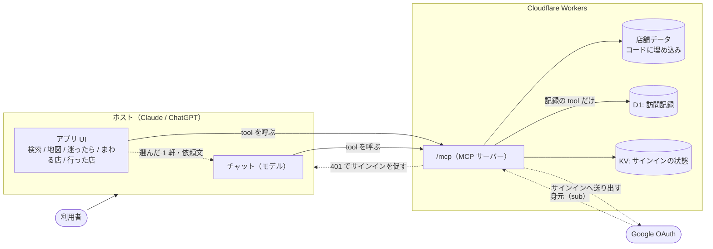
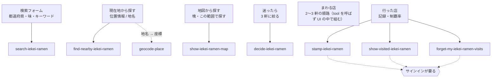
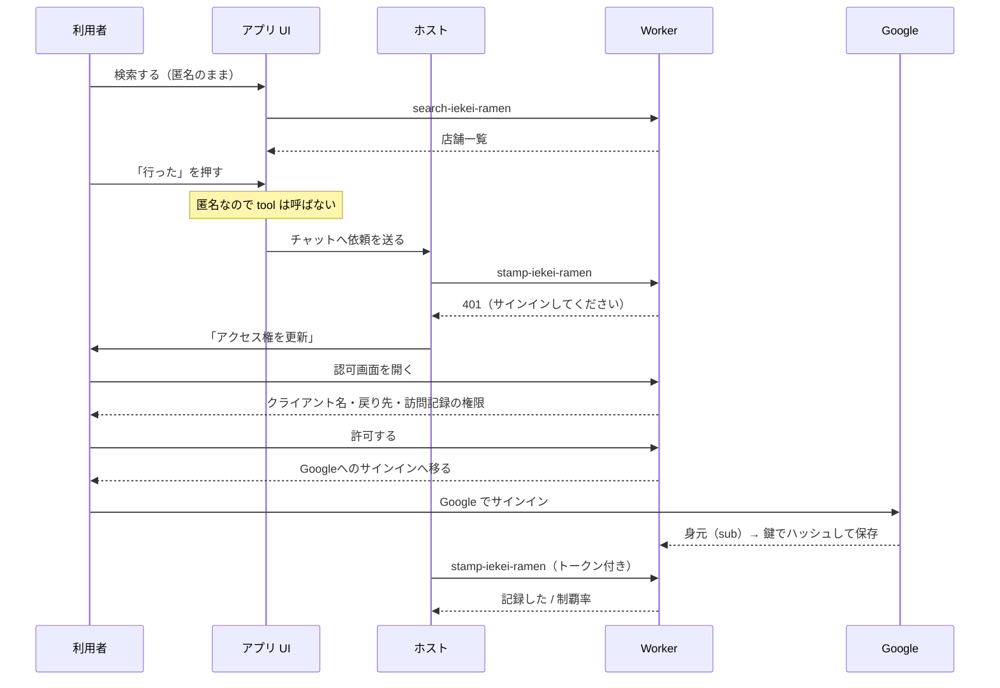

# アーキテクチャ

## 全体像（README から移した。#186）

ホスト（Claude / ChatGPT）の中で UI が動き、**画面の操作もモデルの依頼も、同じ tool を通ります。**
Web 版（`https://iekeiramen.com/`・`/match/`）も、同じ origin の `/mcp` を MCP クライアントで呼ぶ（下の「UI のホスト境界」）。



**UI から呼んでもモデルから呼んでも、返るものは同じ**（画面用の構造化データと、モデル向けの文）。
だから画面で絞り込んだ直後に「この中どれがいい？」と聞けます。

### 機能と tool の対応



### 記録するまで（匿名からサインインまで）



接続先への許可は毎回確認する。「拒否する」を押すと、Googleへ移らずホストへ戻る。
Googleへのサインインは本人確認で、クライアントへの権限付与とは別の手順。

## 構成

**置き場と名前の決まりは [development/structure.md](structure.md)。** ファイルを足す・動かす前に読む（lint とテストで強制している）。下の表は、いまの主なファイルの役割。

| ファイル                                                                | 役割                                                                          |
| ----------------------------------------------------------------------- | ----------------------------------------------------------------------------- |
| `server/`                                                               | サーバー側（Workers と手元の Node）。ブラウザには載らない                     |
| `server/server.ts`                                                      | MCP サーバー。tool に渡す材料を作って登録するだけ                             |
| `server/tools/`                                                         | tool の中身（1 tool 1 ファイル。ファイル名は tool の名前）                    |
| `server/worker.ts`                                                      | Cloudflare Workers エントリ（`/mcp` で Streamable HTTP を受ける）             |
| `server/main.ts`                                                        | ローカル実行エントリ（HTTP / stdio）                                          |
| `src/features/search/main-mcp.tsx`                                      | MCP Apps の入口                                                               |
| `src/features/search/main-web.tsx`                                      | ブラウザで直接開く Web の入口                                                 |
| `src/features/search/SearchApp.tsx`                                     | 共通 UI の外側。作り直しをまたぐ状態（選択・まわる店・焦点）                  |
| `src/features/search/components/SearchAppInner.tsx`                     | 結果の画面。payload ごとに作り直す                                            |
| `src/features/search/`                                                  | 探す（MCP の画面と Web のトップ）。部品は `components/`                       |
| `src/features/search/components/McpConnection.tsx`・`WebConnection.tsx` | MCP Apps と Web の接続・tool 呼び出し・リンクの差し替え                       |
| `src/features/match/`                                                   | 家系マッチ（`/match/`）。Web だけの別ページ                                   |
| `src/features/shindan/`・`src/features/camera/`                         | 家系タイプ診断（`/shindan/`）・家系カメラ（`/camera/`）。同じく別ページ       |
| `src/components/`・`src/hooks/`                                         | 2 つ以上の機能で使う部品・フック                                              |
| `src/lib/`                                                              | 2 つ以上で使い、外部に触るもの（店を探す接続 `feed.ts`・音 `sound.ts`・位置） |
| `src/utils/`・`src/types/`                                              | 2 つ以上で使い、外部に触らないもの・型（サーバーも使う）                      |
| `src/utils/shortlist.ts`                                                | 「迷ったら」の 3 軒の選び方。おすすめ順は作らない                             |
| `src/utils/route.ts`                                                    | 「まわる店」の順番と距離、地図アプリへ渡す URL                                |
| `src/features/search/utils/model-context.ts`                            | 選んだ 1 軒をモデルへ渡す列（順番・失敗・やり直し）                           |
| `src/features/search/utils/shop-brief.ts`                               | モデルに渡す文面。推定には但し書きを付ける                                    |
| `server/lib/oauth.ts`                                                   | Google サインインと、記録の tool に返す 401                                   |
| `server/lib/visits.ts`                                                  | 訪問記録の読み書き（D1）。SQL はここだけ                                      |
| `src/utils/progress.ts`                                                 | 制覇率。順位も称号も作らない                                                  |
| `src/features/search/utils/same-name.ts`                                | 同名の店が並ぶときだけ、名前の隣に出す地名を決める                            |
| `migrations/`                                                           | D1 のスキーマ（デプロイ時に適用）                                             |
| `scripts/data/overpass-query.mjs`                                       | Overpass のクエリと取得の手順。拾う条件を変えるならここだけ見る               |
| `scripts/data/fetch-shops.mjs`                                          | OpenStreetMap から店舗データを取得                                            |
| `scripts/data/judgments.mjs`                                            | TypeSafe に投げる質問と閾値。判定を変えるならここだけ見る                     |
| `scripts/data/judge-all.mjs`                                            | 家系判定を実行して `data/judged.json` に保存                                  |
| `scripts/data/find-duplicates.mjs`                                      | 近い 2 件が同一店舗かを判定して `data/duplicates.json` に保存                 |
| `scripts/data/rescore.mjs`                                              | 保存済みの確率から判定だけ作り直す（API 不要）                                |
| `scripts/data/fill-areas.mjs`                                           | 住所の欠けている店を座標から逆引き（Nominatim）                               |
| `scripts/data/build-dataset.mjs`                                        | 判定結果を整形して `data/shops.json` を生成                                   |

## tool 一覧

| tool                      | 内容                                           |
| ------------------------- | ---------------------------------------------- |
| `search-iekei-ramen`      | 都道府県 / 味の傾向 / キーワードで絞り込み     |
| `find-nearby-iekei-ramen` | 緯度経度から近い順に 5 件（既定）              |
| `show-iekei-ramen-map`    | 日本地図にプロット                             |
| `decide-iekei-ramen`      | 3 軒まで落として、1 軒を理由つきで推してもらう |
| `geocode-place`           | 地名 → 緯度経度（UI が内部で使う。UI なし）    |

サインインした人だけが使える tool（匿名で呼ぶと 401 を返します）:

| tool                           | 内容                       |
| ------------------------------ | -------------------------- |
| `stamp-iekei-ramen`            | 行った印を付ける / 外す    |
| `show-visited-iekei-ramen`     | 行った店と制覇率を見る     |
| `forget-my-iekei-ramen-visits` | 記録を全部消す（戻せない） |

## UI のホスト境界

`src/features/search/SearchApp.tsx` は両方の入口が使う画面と状態を持つ。payload ごとに key で作り直す結果の画面は
`src/features/search/components/SearchAppInner.tsx`、作り直しをまたぐ state（焦点・読み上げ・「行った」の列など）は外側の
`SearchApp.tsx` に置く（#171・#172）。`src/features/search/types/host.ts` が
tool呼び出し・リンク・表示モード・モデルとの会話の契約を定義し、SDKのAppは
`src/features/search/components/McpConnection.tsx` に閉じ込める。MCPの初期通知は従来どおり受け取り、Webでは
`src/features/search/components/WebConnection.tsx` が同じoriginの `/mcp` にSDKクライアントを接続する。
Webの初期検索が揃ってから操作を許可するので、遅れた初回応答がユーザーの検索を
上書きしない。破棄した接続の結果も画面へ反映しない。

Webのテーマは `prefers-color-scheme`、ノッチは `src/features/search/styles/main-web.css` の
`env(safe-area-inset-*)` から同じCSS変数へ渡す。Webの全画面ボタンは出さない。
Playwrightは専用Vite preview（3134）を直接開き、匿名MCP fixture（3131）へ
同じoriginで中継する。地名は既存fixtureで返し、公開Nominatimへは出ない。

画面は `UiHost.capabilities` を見て、会話への依頼と訪問記録の導線を出す。
部品は操作用callbackが渡された場合だけボタンと会話の説明を描く。
Webでは3軒の候補・次の候補・店舗詳細・注文カンペ・まわる店を使える。
モデルへの文脈送信は行わず、訪問記録のボタンとタブは#38のサインイン対応まで出さない。
MCP Appsの会話・サインイン・記録の操作と文言は維持する。

Webの初回toolは `decide-iekei-ramen`（#144。URL に条件があれば `search-iekei-ramen`）。
見出しの上に約束の一言（`PromiseHero`、入口のボタンは持たない）を置き、その下に券売機と
食券を並べる（位置は求めない。全国の 3 軒を出しておく）。探し方の切り替えはタブではなく
見出しの下の小さなリンク（`ModeTabs` の `links`）。地図モードでは絞り込みを地図の横に回す。
入口の `hero`・`introduction`・`primaryMode` だけが見た目を指定し、
MCP Appsの既定の入口・タブ順・並びは変えない。「家系とは」は結果の下に置き、3行の一般論から用語と
同じOrderGuideへ進める。表示できた時点でlocalStorageへ既読を保存し、再訪時は
畳む。保存が使えない場合は毎回開くだけで、検索を止めない。開閉状態はWebの入口が
持つので、検索結果の更新で説明が勝手に畳まれない。

一般論の確認先：[杉田家公式](https://ramensugitaya.com/menu/)、
[町田商店公式](https://www.machidashoten.com/index.html)、
[用語の説明](https://iekei.jp/about-iekei-ramen/lineage)。
用語は呼び方の説明に限り、店舗データに直系などの認定を追加しない。

## MCP Apps の 2 部構成

tool と resource を `_meta.ui.resourceUri` で結び付けるのが MCP Apps の基本形。
UI 付き tool を足すときは、必ず既存の `resourceUri` を指すこと（UI は 1 つで
モードを切り替える設計なので、リソースを増やす必要はない）。

```
registerAppTool(..., { _meta: { ui: { resourceUri } } })
registerAppResource(server, resourceUri, ...)  // APP_HTML を返す
```

tool は 8 つ。UI 付き 7 つ（`search-iekei-ramen` / `find-nearby-iekei-ramen` /
`show-iekei-ramen-map` / `decide-iekei-ramen` と、サインインが要る
`stamp-iekei-ramen` / `show-visited-iekei-ramen` / `forget-my-iekei-ramen-visits`）、
UI 無しの `geocode-place`。

地名検索は、Nominatim への送信開始から応答本文の読込完了まで合計 10 秒で打ち切る
（`GEOCODE_RESPONSE_TIMEOUT_MS`）。本番・手元の `GeocodeGate` は期限切れに
外部通信をキャンセルし、共有している問い合わせを 504 で完了して控えから外す。
次の同じ地名は新しく試行できる。MCP 側は枠待ち最大 3 秒を加えた 13 秒で
Gate 自体の待ちも打ち切り、期限切れは「見つからない」と分けて再試行を案内する。
Gate のない直接検索にも本文を含む 10 秒の期限がある。接続元の連打制限・全体の
1.1 秒の送信間隔・7 日の KV キャッシュは維持する。

`GeocodeGate`は保存の完了後に、予約時刻と直前の実送信からの1.1秒を再確認する。
判定・fetch開始・メモリの送信時刻更新にはawaitを挟まない。
待機後にも保存するので、実体の置き換えで保存権限を失った古い実体は送信しない。
保存値は遅延を含む実送信時刻ではないため、再生成した実体は読み込み完了から
少なくとも1.1秒待つ。さらに先の予約は維持する。過去の保存値でもこの待機を置くので、
再生成直後のキャッシュ未命中検索には最大約1.1秒の追加待機がある。空の保存領域の
最初の1本は待たせない。予約の上限3秒・通信の期限10秒は変更しない。
`server/lib/geocode-gate.test.ts`が7ms/250msの保存遅延・逆順完了・再生成を固定時計で見張り、
`tests/geocode-gate-runtime.test.ts`が使い捨てworkerdのSQLite保存でも確認する。
外部fetchはfixtureで返すため公開Nominatimへは出ない。

## UI へのデータ受け渡し

`structuredContent` に `PayloadSchema`（[server/lib/schema.ts](../../server/lib/schema.ts)）の形で載せる。
`outputSchema` を併記しないとホストに弾かれる。

**重要:** UI が `app.callServerTool()` で呼んだ結果には `ontoolresult` が発火しない。
戻り値から自分で `setPayload` する必要がある（[use-server-tools.ts](../../src/features/search/hooks/use-server-tools.ts) の `call`）。
`ontoolresult` はホスト（モデル）発の呼び出しにだけ来る。

ブラウザの位置取得はMCP呼び出し前に始まるので、通信の通し番号だけでは古い操作を
捨てられない。`NearbyPanel`は操作番号を持ち、タブ移動・再マウント・別の地点指定で
古い位置取得を無効にする。ホスト位置へのフォールバックは、応答を捨てるときに
外側へ残る案内文も更新しない。待っている間もタブは押せる状態を維持する。

## ビルドチェーン

```
src/features/search/main-mcp.tsx ─vite+singlefile→ dist/mcp-app.html ─embed-html.mjs→ src/generated/app-html.ts
                                                                              ↓ server.ts が import
data/shops.json ──────────────────────────────────────────────────→ wrangler が Worker にバンドル
```

Workers にはファイルシステムが無いので、HTML もデータもコードに埋め込む。
`src/generated/` は自動生成なので編集しない（gitignore 済み）。

**UI を変更したら `npm run build:ui` を実行しないとサーバーに反映されない。**
`server/server.ts` は `src/generated/app-html.ts` を読むので、vite ビルドだけでは足りない。
**さらに、起動中の `npm run dev` は再起動しないと古い HTML を返し続ける**
（起動時に import した文字列を持っているため）。動作確認を頼む前に入れ替えること。
