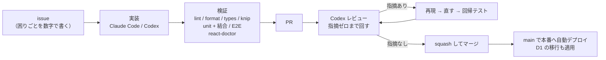

# 開発の進め方・デザイン・コード規約

## 開発の進め方（Claude Code・Codex）

開発には **[Claude Code](https://claude.com/claude-code) と Codex** を使えます。
設計の判断とその理由は [AGENTS.md](../../AGENTS.md) と [DESIGN.md](../../DESIGN.md) に書いてあり、
どちらも共通ルールを読んでから作業します。

共通スキルの正本は `.agents/skills/`、Claude Code向けの入口は `.claude/skills/` の相対シンボリックリンクです。Claude Codeは `CLAUDE.md` の `@AGENTS.md` から共通ルールを読み、Codexは `AGENTS.md` を読みます。Claude Codeでは `/ship-issue 71`、Codexでは `$ship-issue` を指定して対象issueを伝えます。既存の個人設定を変更する必要はありません。

進め方は 1 本道です。

`main` には 2 つのルールセットが重なって効いています（#266）。

| ルールセット       | 中身                                       | 例外                         |
| ------------------ | ------------------------------------------ | ---------------------------- |
| `protect-main`     | PR 必須・CI 必須・強制 push と削除の禁止   | なし（持ち主にも効く）       |
| `require-approval` | 承認 1 件必須。push すると前の承認は外れる | admin の PR 経由のマージだけ |

自分の PR は自分で承認できないので、持ち主は `gh pr merge --admin` でマージします
（`/squash-and-merge` の手順 5）。書き込み権限を持つ App が、自分で作った PR をマージして
本番へ出すことはできません。

守っていることが 3 つあります。

- **数字で再現してから直す。** 「直しました」だけの返信はしません
- **回帰テストは、直す前に戻すと落ちることを確かめてから足す。** 落ちないテストは
  何も見張っていないので、足さずに捨てます
- **なぜそうしたかをコードのコメントに残す。** 何をしているかはコードが語るので、
  コメントは理由の置き場にしています

## デザイン

**見た目の決まりは [DESIGN.md](../../DESIGN.md) に全部書いてある。UI を足す前に読むこと。**

デジタル庁デザインシステム（DADS）の基礎に倣った 3 段構造（プリミティブ →
セマンティック → 部品）で、色だけ家系の茶赤に置き換えている。
値は [src/styles/global.css](../../src/styles/global.css) のトークンから取り、部品側に生の px と色を書かない。

`npx react-doctor design` が UI 側の作法（見出しの絵文字など）を見る。

## コード規約

- コメントは日本語。「なぜそうしたか」を書く。何をしているかはコードで表す。
- UI の文言も日本語。**続く 1 文は改行で分けない**（JSX の改行は空白 1 個に
  畳まれ、和文だと語の途中に隙間が空く）。長い文は定数に出す。
- 型は [src/types/index.ts](../../src/types/index.ts) に集約。zod スキーマは
  [server/lib/schema.ts](../../server/lib/schema.ts) で、両者は手で同期させている。
